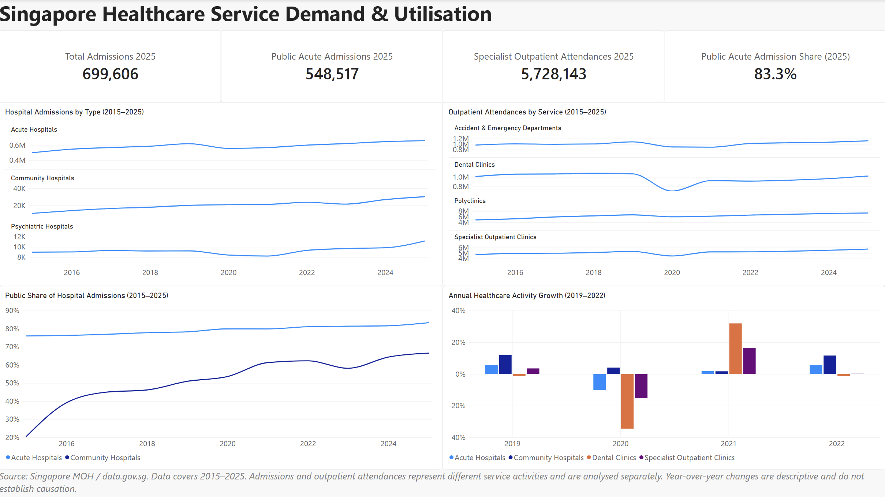
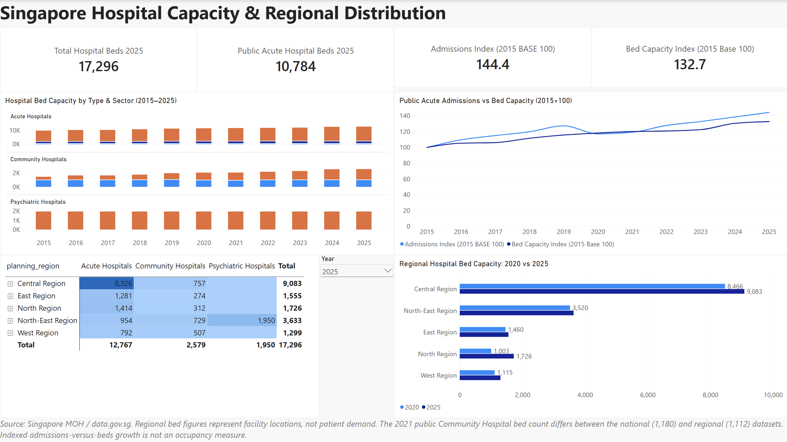

# Singapore Healthcare Utilisation & Capacity Analysis (2015–2025)

End-to-end data analytics project covering hospital admissions, outpatient demand, and inpatient bed capacity in Singapore — built from raw government data through to a two-page Power BI dashboard.

## Business Problem & Objective

Singapore's healthcare system publishes separate official datasets for service utilisation (admissions/attendances) and physical capacity (beds), at different time grains and with no shared key. This project integrates them as far as the data genuinely allows, to understand how demand and capacity have moved together — or apart — from 2015 to 2025.

## Main Analytical Questions

1. How have hospital admissions and outpatient attendances changed from 2015 to 2025?
2. Which services show the strongest growth, and how did they behave around 2020–2022?
3. How has inpatient bed capacity changed across ownership sectors and facility types?
4. How does the growth rate of admissions compare to the growth rate of bed capacity?
5. How is hospital bed capacity distributed across Singapore's planning regions, and how did it grow from 2020 to 2025?

## Tools

**Python** (pandas, NumPy, matplotlib) for data cleaning and exploratory analysis · **DuckDB / SQL** for business-question analysis · **Power BI Desktop** for the dashboard · **Jupyter** for the EDA notebook.

## Data Sources & Licensing

Three datasets from **data.gov.sg** (Singapore Department of Statistics / Ministry of Health), downloaded via the official Dataset Download API:

| Dataset | ID | Coverage | Grain |
|---|---|---|---|
| [Hospital Admissions, Outpatient Attendances & Day Surgeries](https://data.gov.sg/datasets/d_b1ac3356e23ecad918854bbfa3627952/view) | `d_b1ac3356e23ecad918854bbfa3627952` | 1987–2026 | Monthly |
| [Health Facilities & Inpatient Beds (Public/Private/Not-for-Profit)](https://data.gov.sg/datasets/d_852ebeb1165d0ec4cdc89fa7742959d1/view) | `d_852ebeb1165d0ec4cdc89fa7742959d1` | 2009–2025 | Annual |
| [Hospital Beds by Facility Type & Planning Region](https://data.gov.sg/datasets/d_0ed27481bde3ad8abac12be380a441bb/view) | `d_0ed27481bde3ad8abac12be380a441bb` | 2020–2025 | Annual |

**Licence:** [Singapore Open Data Licence v1.0](https://developers.data.gov.sg/open-data-licence), which explicitly permits redistribution, modification, derivative works, and commercial/non-commercial use with attribution. Accordingly:

> Contains information from "Hospital Admissions, Public Sector Outpatient Attendances And Day Surgeries, Monthly", "Health Facilities And Beds In Inpatient Facilities" and "Hospital Beds By Facility Type And Planning Region" accessed on 2026-11-08 from data.gov.sg, made available under the terms of the [Singapore Open Data Licence version 1.0](https://developers.data.gov.sg/open-data-licence).

## Workflow

```
Raw CSVs (data.gov.sg API)
   → Python cleaning (scripts/clean_data.py)
   → Processed CSVs (data/processed/)
   → EDA notebook (notebooks/01_healthcare_eda.ipynb) + 7 PNG charts
   → DuckDB SQL analysis (sql/*.sql → results/sql/*.csv)
   → Power BI dashboard (dashboard/Singapore_Healthcare_Analytics.pbix)
```

Each stage's reasoning, validation, and limitations are documented in `STAGE2_CLEANING_NOTES.md`, `STAGE3_EDA_FINDINGS.md`, and `STAGE4_SQL_FINDINGS.md`.

## Main Findings

All figures verified directly against the processed CSVs and `results/sql/`.

- **Acute Hospital admissions** reached **658,221** in 2025 (+31.7% since 2015); **Community Hospital admissions** grew far faster in relative terms, reaching **30,231** (+183.3% since 2015), off a much smaller base.
- **Public Acute Hospital admissions grew faster than Public Acute Hospital bed capacity**, 2015–2025: indexed to 2015 = 100, admissions reached **144.4** vs. beds at **132.7** by 2025. This is a growth-rate comparison, not an occupancy or utilisation measure — the two are never divided into a ratio anywhere in this project.
- **Seven of eight service categories examined declined in 2020** — the exception was Community Hospital admissions, which grew +4.0% that year. Recovery timing varied by service: Dental Clinics fell sharply and rebounded within a year (-34.4% in 2020, +31.9% in 2021), while Psychiatric Hospital admissions and A&E attendances kept declining into 2021 rather than rebounding immediately (-8.8% then -2.4%, and -16.9% then -0.9%, respectively). These are descriptive year-over-year changes only — no causal link to the pandemic or any other driver is claimed.
- **Hospital bed capacity is concentrated in the Central Region** (≈52.5% of the 2025 national total of 17,296 beds), with Psychiatric Hospital beds located exclusively in the North-East Region.
- **Known, unresolved source discrepancy:** 2021 Public Community Hospital beds are reported as **1,180** in the national facilities dataset and **1,112** in the regional dataset (difference: **68**). Both values are preserved as published — not averaged or corrected — and are flagged on the dashboard itself.

## Dashboard

**Page 1 — Healthcare Service Demand:** admissions and outpatient trends by type, Public vs. Non-Public admission share, and year-over-year growth, 2015–2025.



**Page 2 — Hospital Capacity & Regional Distribution:** bed capacity by facility type and sector, the indexed admissions-vs-beds comparison, and regional bed distribution/growth, with the 2021 discrepancy disclosed directly on the page.



Full build instructions (data model, DAX measures, visual-by-visual spec) are in `POWER_BI_BUILD_GUIDE.md`.

## Reproduction

```bash
pip install -r requirements.txt

# 1. Clean the raw data (writes data/processed/, never touches data/raw/)
python3 scripts/clean_data.py

# 2. Run the EDA notebook end-to-end (writes figures/)
jupyter nbconvert --to notebook --execute --inplace notebooks/01_healthcare_eda.ipynb

# 3. Run the SQL analysis (writes results/sql/)
python3 scripts/run_sql_analysis.py
```

Open `dashboard/Singapore_Healthcare_Analytics.pbix` in Power BI Desktop to view/edit the dashboard. **Note:** if opened on a different machine, Power BI may prompt to repoint the data source — use **Transform Data → Data Source Settings → Change Source** and point to this project's local `data/processed/` folder.

## Limitations

- The three datasets share no row-level key; all comparisons use shared dimensions (year, facility type, sector), not joins.
- Non-Public admissions (utilisation dataset) are not assumed equivalent to Private/Not-for-Profit beds (capacity datasets) — no such mapping is used.
- No occupancy, bed-utilisation, or efficiency ratio is calculated anywhere in this project.
- Regional capacity data (2020–2025) describes facility *location*, not patient residence or demand — no claim is made about any region being under- or over-served.
- No forecasting or causal inference is performed; all year-over-year observations are descriptive.

## Project Structure

```
02_Singapore_Healthcare_Analytics/
├── README.md
├── requirements.txt
├── RESUME_BULLETS.md
├── STAGE2_CLEANING_NOTES.md
├── STAGE3_EDA_FINDINGS.md
├── STAGE4_SQL_FINDINGS.md
├── POWER_BI_BUILD_GUIDE.md
├── data/
│   ├── raw/            # original data.gov.sg CSVs, unmodified
│   └── processed/      # cleaned, analysis-ready CSVs
├── scripts/
│   ├── clean_data.py           # raw -> processed
│   └── run_sql_analysis.py     # runs sql/ -> results/sql/
├── notebooks/
│   └── 01_healthcare_eda.ipynb
├── figures/             # 7 PNG charts exported from the notebook
├── sql/                 # 7 DuckDB SQL query files
├── results/sql/         # 7 CSV outputs, one per query
└── dashboard/
    ├── Singapore_Healthcare_Analytics.pbix
    └── screenshots/
```

## Status

All stages (data collection → cleaning → EDA → SQL analysis → Power BI dashboard → documentation) are complete.
