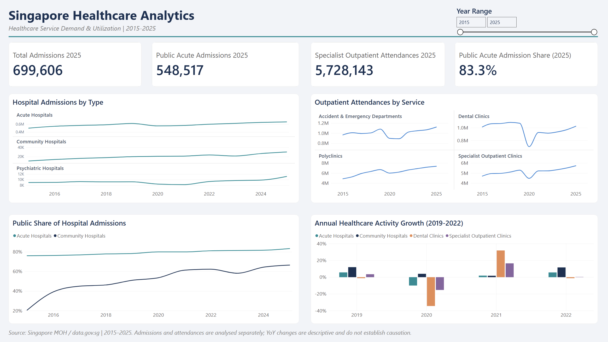
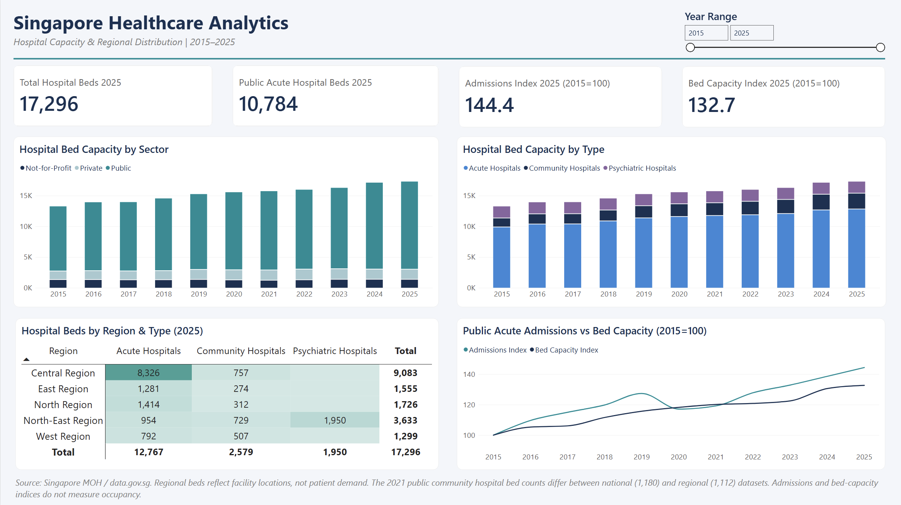

# Singapore Healthcare Utilisation & Capacity Analysis (2015–2025)

## Project overview and objectives

I analysed three official Singapore government datasets to understand how hospital admissions, outpatient activity, and inpatient bed capacity changed between 2015 and 2025, and how that bed capacity is distributed across Singapore's planning regions. I used Python to clean and explore the data, DuckDB SQL to answer specific business questions, and Power BI to bring the findings together in a two-page dashboard.

This is a descriptive study of healthcare activity and infrastructure, not a causal analysis. Where I describe a change coinciding with 2020 to 2022, I'm reporting the timing and size of that change, not attributing it to the pandemic or any other specific cause.

The questions I set out to answer were:

1. How have hospital admissions and outpatient attendances changed from 2015 to 2025?
2. Which services show the strongest growth, and how did they behave around 2020 to 2022?
3. How has inpatient bed capacity changed across ownership sectors and facility types?
4. How does the growth rate of admissions compare to the growth rate of bed capacity?
5. How is hospital bed capacity distributed across Singapore's planning regions, and how did it grow from 2020 to 2025?

## Data source and collection date

I downloaded three datasets from data.gov.sg (Singapore Department of Statistics / Ministry of Health) using the official Dataset Download API on **8 November 2026**:

| Dataset | ID | Coverage | Grain |
|---|---|---|---|
| [Hospital Admissions, Public Sector Outpatient Attendances & Day Surgeries](https://data.gov.sg/datasets/d_b1ac3356e23ecad918854bbfa3627952/view) | `d_b1ac3356e23ecad918854bbfa3627952` | 1987 to 2026 | Monthly |
| [Health Facilities & Inpatient Beds (Public/Private/Not-for-Profit)](https://data.gov.sg/datasets/d_852ebeb1165d0ec4cdc89fa7742959d1/view) | `d_852ebeb1165d0ec4cdc89fa7742959d1` | 2009 to 2025 | Annual |
| [Hospital Beds by Facility Type & Planning Region](https://data.gov.sg/datasets/d_0ed27481bde3ad8abac12be380a441bb/view) | `d_0ed27481bde3ad8abac12be380a441bb` | 2020 to 2025 | Annual |

My analysis focuses on 2015 to 2025, the period common to the two national datasets. The regional dataset only covers 2020 to 2025, so any regional finding is limited to that shorter window. The three datasets also differ in grain (monthly versus annual) and in scope (national totals versus regional breakdowns), and they share no row-level key; I discuss what that means for comparability in Data-quality methodology and limitations below. The outpatient attendance figures follow the monthly dataset's own public-sector reporting scope; they do not necessarily capture all private-sector outpatient activity in Singapore. Full licensing and attribution details are in Attribution and licensing at the end of this document.

## Workflow

| Stage | Tooling | Output |
|---|---|---|
| 1. Data acquisition and inspection | data.gov.sg API | Three original CSVs, inspected for structure, coverage, and placeholder values before any cleaning |
| 2. Cleaning | Python, pandas | Three analysis-ready CSVs in `data/processed/`, with 741 admissions category-months reconciled against source totals |
| 3. Exploratory analysis | Python, pandas, matplotlib, Jupyter | A public EDA notebook and 7 PNG charts |
| 4. Business analysis | DuckDB SQL | 7 SQL queries answering the 5 business questions plus a source-reconciliation check, all exported to `results/sql/` |
| 5. Dashboard | Power BI Desktop | A two-page report built manually from a 4-table model (3 fact tables plus a Year dimension) and DAX measures, documented in `POWER_BI_BUILD_GUIDE.md` |

I validated each stage before moving on to the next: the cleaning script's own reconciliation checks, independent SQL re-derivation of figures also produced in the notebook, and a direct comparison of every dashboard KPI against the underlying CSVs. Full methodology and validation detail for each stage is in `STAGE2_CLEANING_NOTES.md`, `STAGE3_EDA_FINDINGS.md`, and `STAGE4_SQL_FINDINGS.md`.

## Dashboard

### Page 1: Service Demand & Utilisation



Admissions and outpatient attendance trends by type, the Public admission share for Acute and Community Hospitals, and annual healthcare activity growth, all covering 2015 to 2025. An interactive year-range slicer lets most trend visuals be filtered to a custom period; the KPI cards and the annual-growth chart stay fixed to their own reporting window (2025, and 2019 to 2022 respectively) regardless of the slicer selection.

### Page 2: Hospital Capacity & Regions



Hospital bed capacity by ownership sector and by hospital type, a regional matrix of hospital beds by facility type, and the indexed comparison of Public Acute admissions versus bed capacity. The same year-range slicer and fixed 2025 KPI cards are used here. The regional matrix shows the latest available year within the selected slicer range rather than a sum across that range. Regional coverage begins in 2020, so a range that ends before 2020 leaves the matrix empty and its title reads "(No Data)". The 2021 national-versus-regional bed discrepancy (see Key findings) is disclosed directly on this page.

The PBIX file itself is included in this repository at `dashboard/Singapore_Healthcare_Analytics.pbix`. `POWER_BI_BUILD_GUIDE.md` documents the data model and the page-by-page build steps used to construct it; it keeps the 20 original Stage 5A DAX formulas as a historical reference and documents five measures used by the final dashboard, whose formulas I copied from Power BI Desktop. Those five were checked by me manually and were not independently extracted from the file; the guide's opening section states what has and hasn't been verified.

## Key findings

All figures below are read directly from the processed CSVs and `results/sql/`.

- Acute Hospital admissions reached **658,221** in 2025, up **31.7%** since 2015. Community Hospital admissions reached **30,231** in 2025, up **183.3%** since 2015, a much faster relative increase off a smaller base.
- Public Acute Hospital admissions grew faster than Public Acute Hospital bed capacity over the same period. Indexed to 2015 = 100, admissions reached **144.4** by 2025 while beds reached **132.7**. The admissions and the beds come from separate datasets, so the two indices compare how two related public-sector measures changed. They don't link patients to beds. This is not an occupancy, efficiency or causal measure, and admissions and beds are never divided into a ratio anywhere in this project.
- Seven of the eight service categories I examined declined in 2020. Community Hospital admissions was the exception, growing **4.0%** that year. Recovery timing varied: Dental Clinic attendances fell **34.4%** in 2020 and rebounded **31.9%** in 2021, while other services took longer to recover. These are descriptive year-over-year changes; I'm not claiming the pandemic or any other specific cause.
- Hospital bed capacity is concentrated in the Central Region, which held approximately **52.5%** of the 2025 national total of 17,296 beds. Psychiatric Hospital beds are located exclusively in the North-East Region.
- I found a genuine, unresolved discrepancy in the 2021 Public Community Hospital bed count: the national facilities dataset reports **1,180** beds, while the regional dataset reports **1,112** (a difference of **68**). I've preserved both values as published rather than averaging or correcting either one, and the dashboard discloses this directly.

## Data-quality methodology and limitations

**What I did:**
- Reshaped both wide-format source files (monthly admissions, regional beds) into long format, parsing the hierarchical row structure (facility type, sector, region) encoded in each file's indentation.
- Treated missing historical observations (periods before a series started reporting) as genuinely missing rather than zero, and reconciled 741 admissions category-months against their source totals before dropping the now-redundant parent-total rows, to avoid double counting admissions by both category and sector.
- Kept Public and Non-Public admissions as a separate distinction from the Private/Not-for-Profit/Public bed-ownership categories in the two capacity datasets. I don't assume the two classifications are identical; the admissions-versus-beds index treats "Public" in each dataset as a related, not identical, measure.

**Limitations:**
- The three datasets have no shared row-level key and different time grains (monthly admissions versus annual capacity), so every comparison is at the year/category level, never a direct join.
- Regional bed figures describe where facilities are located, not where patients live or where demand originates.
- The 2021 national-versus-regional bed discrepancy (68 beds, described above) remains unresolved; I'm not able to determine which figure, if either, is correct.
- No occupancy rate, bed-utilisation rate, or other efficiency ratio is calculated anywhere in this project, and no causal inference is drawn from any year-over-year change.

Further detail on each stage's specific decisions and checks is in `STAGE2_CLEANING_NOTES.md`, `STAGE3_EDA_FINDINGS.md`, and `STAGE4_SQL_FINDINGS.md`.

## Repository structure

```
data/raw/              Original data.gov.sg CSVs, unmodified
data/processed/        Cleaned, analysis-ready CSVs produced by scripts/clean_data.py
scripts/                clean_data.py (raw -> processed) and run_sql_analysis.py (sql/ -> results/sql/)
notebooks/              01_healthcare_eda.ipynb, the public EDA notebook
figures/                7 PNG charts exported from the notebook
sql/                    7 DuckDB SQL query files, one per business question plus a reconciliation check
results/sql/            7 CSV outputs, one per query
dashboard/              Singapore_Healthcare_Analytics.pbix and both dashboard screenshots
requirements.txt        Python dependencies
STAGE2_CLEANING_NOTES.md, STAGE3_EDA_FINDINGS.md, STAGE4_SQL_FINDINGS.md
                        Stage-by-stage methodology and validation detail
POWER_BI_BUILD_GUIDE.md Data model, DAX measures, and dashboard build instructions
RESUME_BULLETS.md       Short summary of this project for a resume
```

## Reproducibility

The raw and processed CSVs are already included in this repository, so you don't need to re-download or re-run anything to inspect the data. To regenerate everything from scratch:

```bash
pip install -r requirements.txt

# 1. Clean the raw data (writes data/processed/, never touches data/raw/)
python3 scripts/clean_data.py

# 2. Run the EDA notebook end-to-end (writes figures/)
jupyter nbconvert --to notebook --execute --inplace notebooks/01_healthcare_eda.ipynb

# 3. Run the SQL analysis (writes results/sql/)
python3 scripts/run_sql_analysis.py
```

To open the dashboard, open `dashboard/Singapore_Healthcare_Analytics.pbix` in Power BI Desktop. If you open it on a different machine, Power BI may prompt you to repoint the data source: use **Transform Data → Data Source Settings → Change Source** and point it at this repository's local `data/processed/` folder.

## Attribution and licensing

This project's three source datasets are published by data.gov.sg under the [Singapore Open Data Licence version 1.0](https://developers.data.gov.sg/open-data-licence), which permits redistribution, modification, and commercial and non-commercial use, subject to attribution. Accordingly:

> Contains information from "Hospital Admissions, Public Sector Outpatient Attendances And Day Surgeries, Monthly", "Health Facilities And Beds In Inpatient Facilities" and "Hospital Beds By Facility Type And Planning Region" accessed on 8 November 2026 from data.gov.sg, made available under the terms of the [Singapore Open Data Licence version 1.0](https://developers.data.gov.sg/open-data-licence).

Because this licence explicitly permits redistribution and derivative works, this repository includes the original raw CSVs, the cleaned processed CSVs, and the Power BI `.pbix` file itself.
